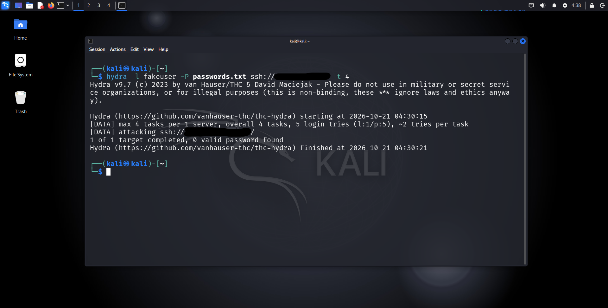
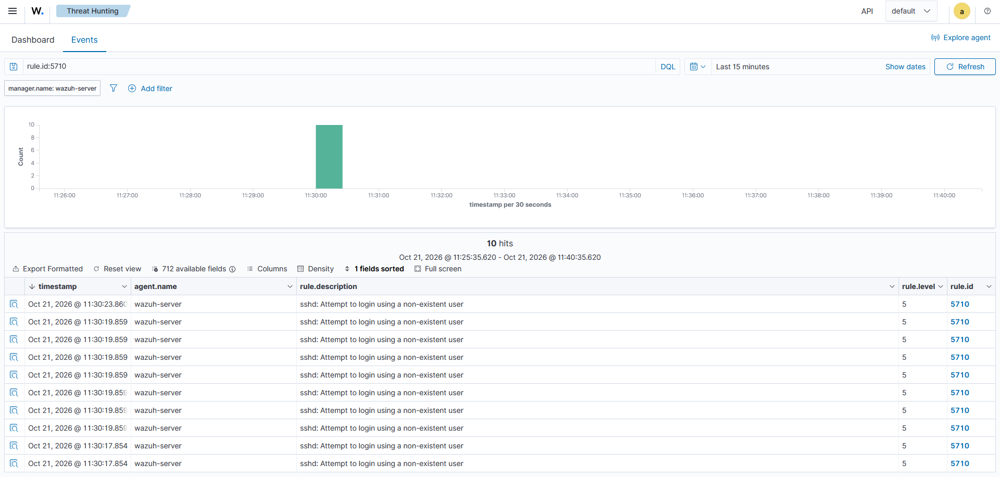
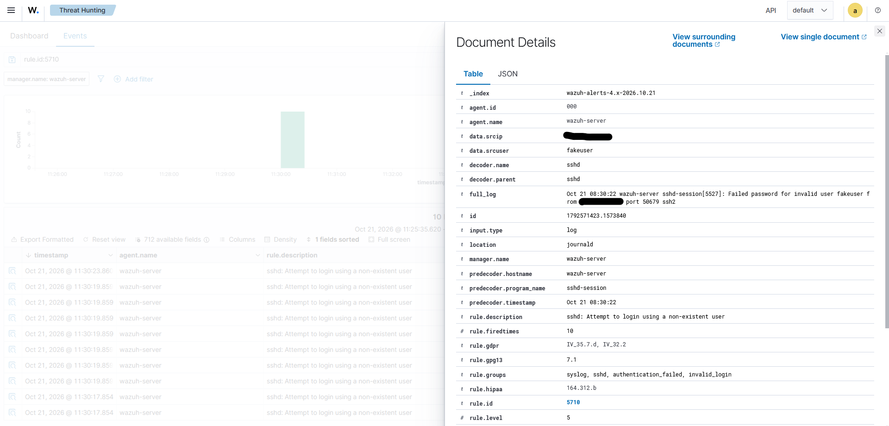

# 01. Детект SSH-брутфорса

## 🎯 Цель
Симулировать атаку методом перебора паролей (Brute-force) по протоколу SSH и продемонстрировать её обнаружение с помощью Wazuh SIEM.

## 🛠 Стек и инструменты
- **Атакующий:** Kali Linux (утилита Hydra)
- **Цель:** Wazuh Server (Amazon Linux 2023)
- **SIEM:** Wazuh v4.14.9

## 📐 Сценарий атаки
Атакующая машина (Kali) выполняет перебор паролей по SSH к серверу Wazuh. Используется словарь из 5 популярных паролей и несуществующий пользователь `fakeuser`.

*Рис 1. Процесс брутфорса в терминале Kali (найдено 0 валидных паролей).*

## 🔍 Детали детекта в Wazuh
Wazuh Agent на сервере успешно считал лог `/var/log/auth.log` и сгенерировал алерты.

*Рис 2. Всплеск событий в Wazuh Dashboard (Threat Hunting -> Events).*

**Разбор события:**
- **Rule ID:** `5710`
- **Rule Description:** `sshd: Attempt to login using a non-existent user`
- **Rule Level:** `5` (низкий уровень критичности, требует корреляции)
- **Имя пользователя (srcuser):** `fakeuser`
- **Источник (srcip):** *[IP-адрес скрыт]*

*Рис 3. Детальный разбор JSON-полей события.*

## 🛡 Маппинг на MITRE ATT&CK
- **Tactic:** Credential Access (TA0006)
- **Technique:** Brute Force: Password Guessing (T1110.001)

## ✅ Вердикт и рекомендации
- **Вердикт:** Атака зафиксирована. Успешного входа не произошло (0 валидных паролей).
- **Рекомендации:** В реальной среде при серии таких событий (Rule 5712 / Level 10) требуется временная блокировка IP-адреса источника через Firewall, а также внедрение Fail2Ban или настройка Key-based аутентификации с отключением входа по паролю.

## 📝 Чему я научился
В ходе лабораторной работы я отработал навыки запуска атаки Hydra, настройки Wazuh для чтения логов аутентификации и поиска событий по конкретным `rule.id`. Я научился читать поля `data.srcuser` и `data.srcip` и сопоставлять инцидент с матрицей MITRE ATT&CK.
