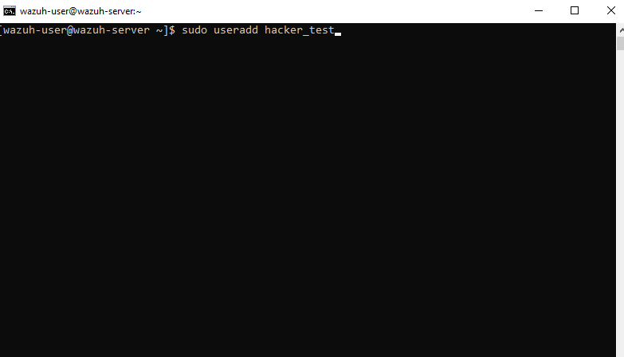
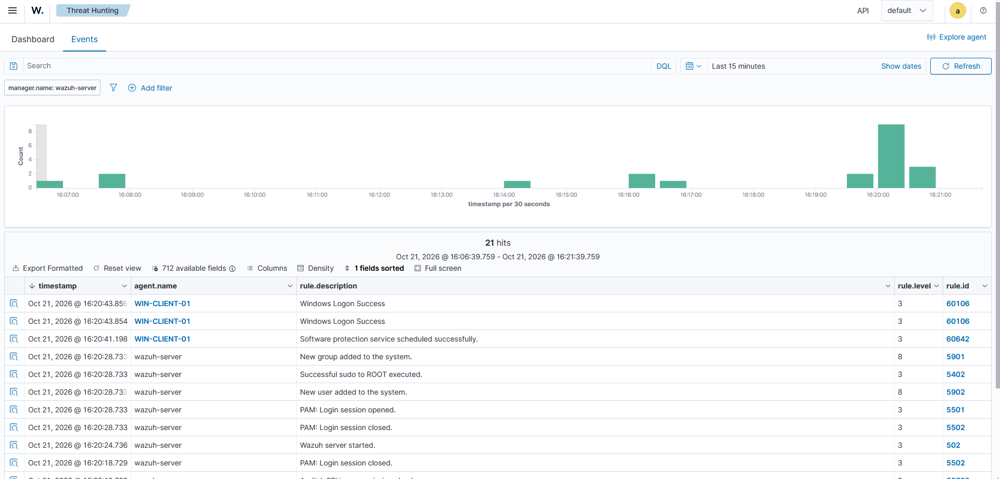
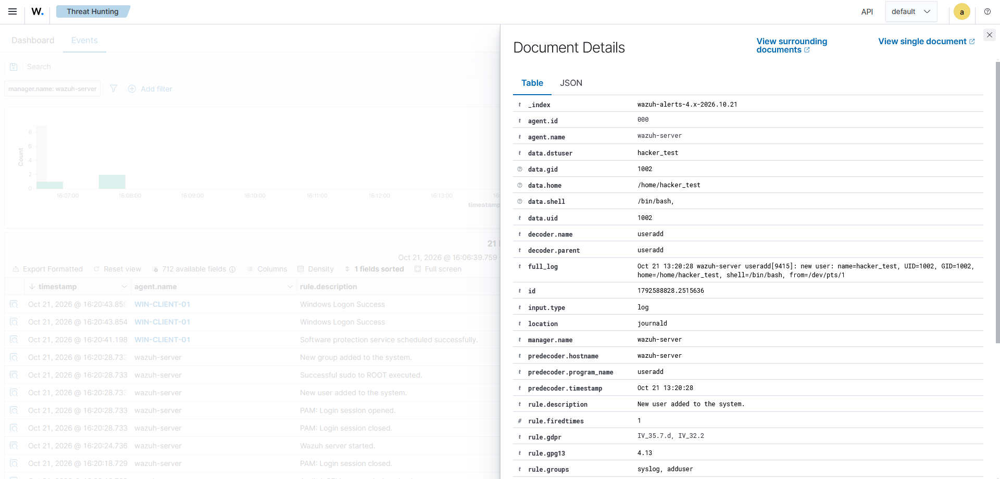

# 02. Обнаружение создания локального пользователя (Local Account Creation)

## 🎯 Цель
Продемонстрировать обнаружение попытки закрепления в системе (Persistence) путем создания нового локального пользователя. Wazuh должен зафиксировать выполнение команды `useradd` и создать алерт.

## 🛠 Стек и инструменты
- **Цель:** Wazuh Server (Amazon Linux 2023)
- **SIEM:** Wazuh v4.14.9 (модуль Syslog/Auditd)

## 📐 Сценарий
Злоумышленник (или администратор) создает нового локального пользователя с помощью команды `useradd`. Мы имитируем это действие и смотрим, как SIEM реагирует на изменение конфигурации учетных записей.

*Рис 1. Создание локального пользователя hacker_test на сервере.*

## 🔍 Детали детекта в Wazuh

*Рис 2. Всплеск событий в Wazuh Dashboard (Threat Hunting -> Events).*

**Разбор события:**
- **Rule ID:** `5902`
- **Rule Description:** `New user added to the system.`
- **Rule Level:** `8` (средний уровень критичности)
- **User (dstuser):** `hacker_test`

*Рис 3. Детальный разбор события, включая сырой лог (full_log).*

Благодаря сырому логу (`full_log`), мы видим точное время создания пользователя, его UID/GID, а также путь к домашней директории и используемую оболочку (`/bin/bash`).

## 🛡 Маппинг на MITRE ATT&CK
- **Tactic:** Persistence (TA0003)
- **Technique:** Create Account: Local Account (T1136.001)

## ✅ Вердикт и рекомендации
- **Вердикт:** Создание локального пользователя зафиксировано. Если это действие не было согласовано с ИТ-отделом и не является частью легитимного процесса, оно классифицируется как попытка закрепления в системе (Persistence).
- **Рекомендации:** Проверить, с какого IP-адреса и под какой учетной записью была выполнена команда (поле `full_log`). При обнаружении аномалии — заблокировать сессию, удалить учетную запись `hacker_test` и проверить систему на наличие других вредоносных артефактов.

## 📝 Чему я научился
Я отработал навык поиска событий по правилу `5902`. Научился анализировать сырые логи (`full_log`) для восстановления контекста действия (кто, когда и как создал пользователя), а также сопоставил это действие с тактикой Persistence из матрицы MITRE ATT&CK.
