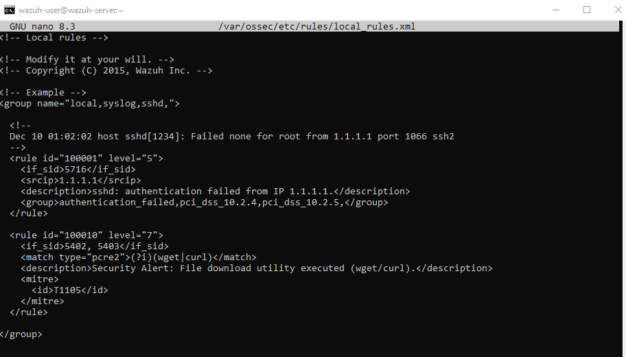
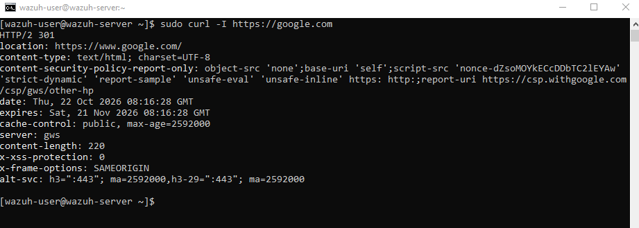
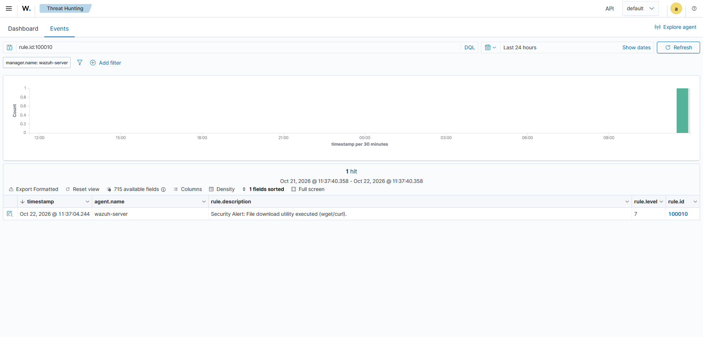
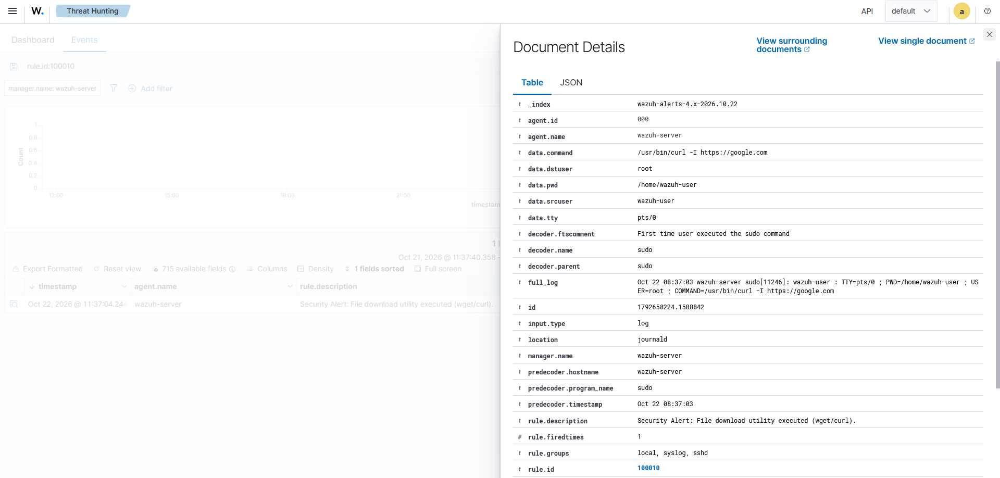

# 03. Кастомное правило Wazuh (Custom Detection Rule)

## 🎯 Цель
Продемонстрировать навык Detection Engineering — написание собственного правила для Wazuh SIEM. Правило должно детектировать использование утилит для скачивания файлов из интернета (`wget`, `curl`), что часто используется злоумышленниками для загрузки вредоносного ПО (Payload).

## 🛠 Стек и инструменты
- **Цель:** Wazuh Server (Amazon Linux 2023)
- **SIEM:** Wazuh v4.14.9

## 📐 Настройка правила
По умолчанию Wazuh не генерирует высокоуровневых алертов на обычное использование `curl`. Мы добавили кастомное правило в файл `/var/ossec/etc/rules/local_rules.xml`.

*Рис 1. XML-код кастомного правила с ID 100010.*

**Логика правила:**
- `<if_sid>5402, 5403</if_sid>` — правило срабатывает на базовые события выполнения команд через sudo.
- `<match type="pcre2">(?i)(wget|curl)</match>` — использует регулярное выражение (PCRE2) для поиска утилит без учета регистра.
- `level="7"` — устанавливает средний уровень критичности.

## 🔍 Детали детекта
Для проверки я выполнил команду `sudo curl -I https://google.com`. 

*Рис 2. Выполнение тестовой команды на сервере.*

Wazuh успешно обнаружил это действие с помощью нашего нового правила.

*Рис 3. Поиск событий по кастомному правилу в Wazuh Dashboard.*

*Рис 4. Детальный разбор события: видно поле data.command с запущенным curl.*

## 🛡 Маппинг на MITRE ATT&CK
- **Tactic:** Command and Control (TA0011)
- **Technique:** Ingress Tool Transfer (T1105)

## ✅ Вердикт и рекомендации
- **Вердикт:** Срабатывание кастомного правила подтверждает, что механизм детекта работает корректно. Само по себе использование `curl` легитимно, но в контексте работы от `root` или на серверах, где это не предусмотрено, требует внимания аналитика.
- **Рекомендации:** Проверить, какой именно URL скачивался. Если домен неизвестен или подозрителен — изолировать машину и провести анализ на наличие загруженных файлов.

## 📝 Чему я научился
Я освоил синтаксис написания правил Wazuh (XML). Понял, как использовать базовые правила (`if_sid`) и регулярные выражения (`pcre2`) для фильтрации событий. Научился применять правило на практике и подтверждать его работоспособность через SIEM.
