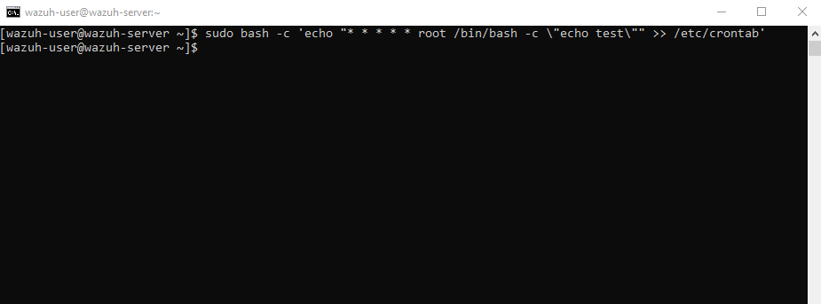
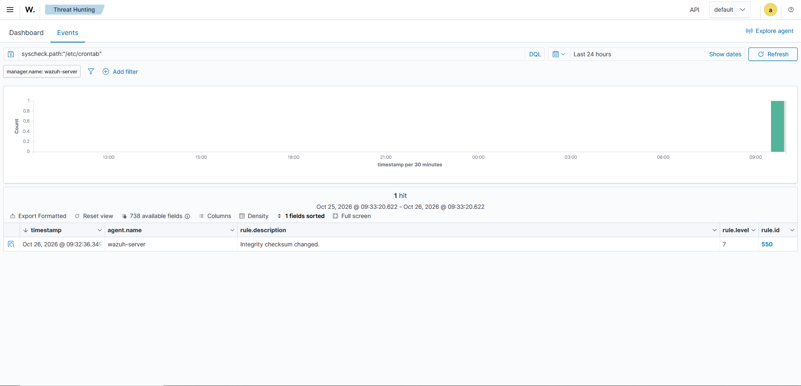
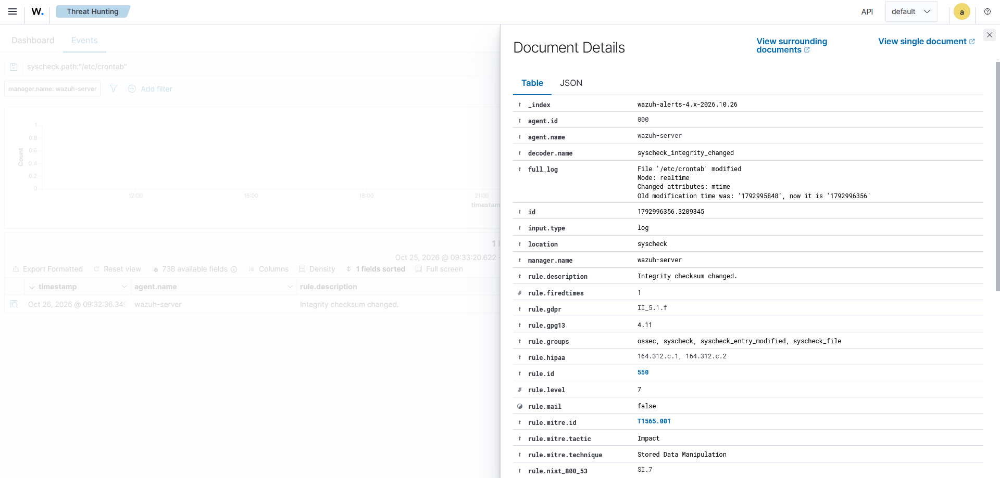

# 04. Обнаружение персистентности через Cron (Linux Persistence)

## 🎯 Цель
Продемонстрировать обнаружение попытки закрепления в системе (Persistence) через модификацию системного планировщика задач `cron`. Злоумышленники часто используют эту технику для автоматического запуска вредоносного кода с заданной периодичностью.

## 🛠 Стек и инструменты
- **Цель:** Wazuh Server (Amazon Linux 2023)
- **SIEM:** Wazuh v4.14.9 (модуль Syscheck / FIM)

## 📐 Сценарий атаки
Атакующий получает доступ к серверу и добавляет задачу в системный файл `/etc/crontab`, чтобы обеспечить себе постоянный доступ. Мы имитируем добавление задачи, которая выполняется каждую минуту от имени `root`.

*Рис 1. Добавление задачи в /etc/crontab.*

## 🔍 Детали детекта в Wazuh
Модуль File Integrity Monitoring (FIM) в Wazuh отслеживает изменения критических системных файлов в реальном времени.

*Рис 2. Поиск событий по модификации /etc/crontab в Wazuh Dashboard.*

**Разбор события:**
- **Rule ID:** `550` (Integrity checksum changed)
- **File Path:** `/etc/crontab`
- **Mode:** `realtime`

*Рис 3. Детальный разбор события. В поле `full_log` зафиксировано изменение файла, а Wazuh автоматически определил технику MITRE.*

## 🛡 Маппинг на MITRE ATT&CK
- **Tactic:** Persistence (TA0003), Execution (TA0002)
- **Technique:** Scheduled Task/Job: Cron (T1053.003)

## ✅ Вердикт и рекомендации
- **Вердикт:** Модификация файла `/etc/crontab` зафиксирована в режиме реального времени. Если это действие не было согласовано с администраторами, оно классифицируется как попытка закрепления в системе.
- **Рекомендации:** Проверить, что именно запускает добавленная задача. Удалить несанкционированную запись из `crontab`. Проверить логи аутентификации на предмет компрометации учетной записи, с которой были внесены изменения.

## 📝 Чему я научился
Я отработал навык использования модуля FIM для отслеживания изменений в критических файлах конфигурации. Научился настраивать режим `realtime` в `ossec.conf`, а также анализировать поле `full_log` для быстрого определения сути изменений.
